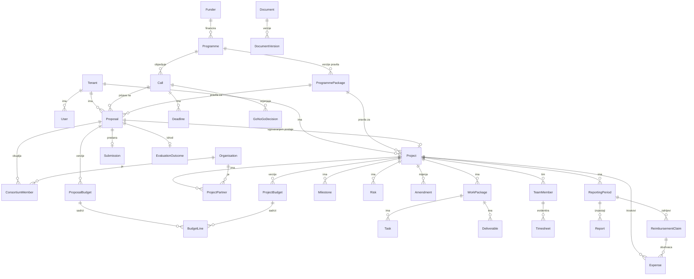

# Domenski model v1 (WP0.4)

**Status:** v1 – radna osnova za prototip (WP0.5) i MVP (faza 1). Mijenja se nakon intervjua (WP0.6).
**Načela:** generički i neovisan o bilo kojem postojećem sustavu (ADR-0005); pravila programa su podaci, ne kod (ADR-0004); svaki zapis pripada točno jednom stanaru (ADR-0002); sve promjene poslovnih podataka ostavljaju revizijski trag (ADR-0003).

Rječnik: hrvatski nazivi entiteta koriste se u dokumentaciji i sučelju, engleski identifikatori u kodu i shemi baze (u zagradama).

## 1. Moduli (ograničeni konteksti)

| # | Modul | Odgovornost | Ključni entiteti |
| --- | --- | --- | --- |
| M1 | Stanar i identitet (`tenancy`) | institucija-kupac, korisnici, uloge, organizacijske jedinice | Stanar, Korisnik, Uloga, OrgJedinica |
| M2 | Programi i paketi (`programs`) | katalog financijera i programa, verzionirani paketi pravila | Financijer, Program, PaketPrograma |
| M3 | Radar poziva (`calls`) | praćenje poziva, ocjena prikladnosti, odluka go/no-go | Poziv, Rok, OcjenaPrikladnosti, OdlukaGoNoGo |
| M4 | Partneri (`partners`) | registar organizacija i kontakata izvan stanara | Organizacija, Kontakt |
| M5 | Prijava (`proposals`) | priprema prijave: tim, konzorcij, struktura rada, proračun prijave, predaja | Prijava, ČlanKonzorcija, ProračunPrijave, Predaja, IshodEvaluacije |
| M6 | Projekt i provedba (`projects`) | ugovoreni projekt: radni paketi, zadaci, isporuke, prekretnice, rizici, promjene ugovora | Projekt, Partner, RadniPaket, Zadatak, Isporuka, Prekretnica, Rizik, Amandman |
| M7 | Financije (`finance`) | proračun projekta po partneru i kategoriji, troškovi, timesheetovi, zahtjevi za nadoknadu | ProračunProjekta, StavkaProračuna, Trošak, Timesheet, ZahtjevZaNadoknadu |
| M8 | Izvještavanje (`reporting`) | izvještajna razdoblja i izvještaji prema financijeru | IzvještajnoRazdoblje, Izvještaj |
| M9 | Dokumenti (`documents`) | datoteke, verzije, veze na entitete, predlošci | Dokument, VerzijaDokumenta, Predložak |
| M10 | Portfelj (`portfolio`) | agregirani pogled stanara: pokazatelji, opterećenje ljudi, kalendar rokova | (pogledi, bez vlastitih agregata) |
| M11 | Revizijski zapis (`audit`) | nepromjenjivi dnevnik promjena i AI sadržaja | ZapisRevizije |

Moduli komuniciraju kroz javna sučelja i domenske događaje (npr. `PrijavaUgovorena` → M6 stvara Projekt). Modul ne čita tuđe tablice izravno.

## 2. Entiteti i atributi

Zajednički atributi svakog agregata: `id` (UUID v7), `tenant_id`, `created_at`, `created_by`, `updated_at`, `updated_by`, `version` (optimistično zaključavanje). Novčani iznosi: cijeli broj u centima + oznaka valute (ISO 4217); zadana valuta stanara, EUR.

### M1 Stanar i identitet
| Entitet | Opis | Ključni atributi |
| --- | --- | --- |
| Stanar (`Tenant`) | institucija-kupac; granica izolacije podataka | naziv, OIB/PIC/drugi identifikatori, paket pretplate, zadana valuta, jezik, postavke |
| Korisnik (`User`) | osoba s pristupom | e-pošta, ime, status, način prijave (lozinka+MFA / OIDC / SAML), org. jedinica |
| Uloga (`Role`) | skup dozvola; sistemske i prilagođene | naziv, dozvole[], opseg (stanar / projekt) |
| Dodjela uloge (`RoleAssignment`) | korisnik ↔ uloga, po potrebi ograničena na projekt | user, role, project? |
| Org. jedinica (`OrgUnit`) | hijerarhija (sastavnica, zavod, ured za projekte) | naziv, nadređena jedinica, šifra |

Sistemske uloge v1: administrator stanara, voditelj ureda za projekte, voditelj projekta, član tima, financije/računovodstvo, čitatelj (uprava).

### M2 Programi i paketi
| Entitet | Opis | Ključni atributi |
| --- | --- | --- |
| Financijer (`Funder`) | tko financira | naziv, država/EU, web, portal za predaju (npr. Funding & Tenders, fondovieu) |
| Program (`Programme`) | okvir unutar financijera (Horizon Europe, NPOO, Interreg, HRZZ…) | naziv, razdoblje od–do, financijer |
| Paket programa (`ProgrammePackage`) | verzionirana pravila programa (ADR-0004) | program, verzija (semver), vrijedi od, status (nacrt/objavljen/zastario), JSON sadržaj (odjeljak 4) |

Paketi su **globalni** (dijeljeni među stanarima, održava ih Arqus) ili **stanarski** (stanar prilagođava kopiju ili dodaje interni program). Projekt i prijava uvijek pokazuju na točnu verziju paketa.

### M3 Radar poziva
| Entitet | Opis | Ključni atributi |
| --- | --- | --- |
| Poziv (`Call`) | konkretni natječaj / tema | program, identifikator (npr. HORIZON-CL4-2027-…), naslov, sažetak, proračun poziva, očekivani broj projekata, vrsta akcije, izvor (URL), status (najavljen/otvoren/zatvoren/otkazan), oznake (ključne riječi, TRL) |
| Rok (`Deadline`) | jedan ili više rokova (jednofazni, dvofazni) | poziv, vrsta (predaja faza 1/2, info-dan, interni rok), datum-vrijeme, vremenska zona |
| Ocjena prikladnosti (`FitAssessment`) | ocjena poziva za stanara | poziv, kriteriji i bodovi (strateško uklapanje, kapacitet, vjerojatnost, financijski učinak), ukupno, komentar, ocjenjivač |
| Odluka go/no-go (`GoNoGoDecision`) | formalna odluka | poziv, odluka (go / no-go / pratiti), obrazloženje, donositelj, datum; `go` stvara Prijavu u statusu `ideja` |

Pozivi mogu biti **globalni** (uvoz iz javnih izvora: Funding & Tenders Portal, fondovieu, HRZZ) i **stanarski** (ručno uneseni). Stanar vidi globalne + svoje.

### M4 Partneri
| Entitet | Opis | Ključni atributi |
| --- | --- | --- |
| Organizacija (`Organisation`) | pravna osoba izvan stanara (partner, podugovaratelj, financijer-posrednik) | naziv, država, identifikatori (PIC, OIB, VAT), vrsta (sveučilište, institut, MSP, veliko poduzeće, javno tijelo, NVO), web |
| Kontakt (`Contact`) | osoba u organizaciji | ime, e-pošta, telefon, uloga, organizacija, privola za kontakt (GDPR) |

Stanar je i sam Organizacija (vlastiti zapis), kako bi konzorcij i partneri projekta bili jednoobrazni.

### M5 Prijava
| Entitet | Opis | Ključni atributi |
| --- | --- | --- |
| Prijava (`Proposal`) | priprema jedne prijave na poziv | poziv, paket programa (verzija), akronim, naslov, uloga stanara (koordinator / partner), voditelj prijave, status (odjeljak 3), interni rokovi, sažetak |
| Član konzorcija (`ConsortiumMember`) | organizacija u prijavi | prijava, organizacija, uloga (koordinator/partner/pridruženi/podugovaratelj), redni broj, kontakt, status potvrde (pozvan/potvrđen/odustao), potpisana pisma (LoI, mandat) |
| Struktura rada prijave (`ProposalWorkPackage`, `ProposalTask`, `ProposalDeliverable`, `ProposalMilestone`) | planirani WP-ovi, zadaci, isporuke, prekretnice | naziv, voditelj (član konzorcija), mjeseci od–do, PM-ovi po partneru |
| Proračun prijave (`ProposalBudget`) | verzionirani proračun po partneru i kategoriji iz paketa | prijava, verzija, status (nacrt/zaključan), stavke[] |
| Stavka proračuna (`BudgetLine`) | partner × kategorija troška (× WP po potrebi) | partner, šifra kategorije iz paketa, količina, jedinica, jedinična cijena, iznos, obrazloženje; izvedeno: neizravni troškovi, zatraženi doprinos |
| Predaja (`Submission`) | zapis o predaji | prijava, datum-vrijeme, portal, referentni broj, tko je predao, snimka proračuna i dokumenata |
| Ishod evaluacije (`EvaluationOutcome`) | rezultat | prijava, ishod (financirano / rezervna lista / odbijeno / povučeno), bodovi po kriterijima, prag, ESR/komentari, datum |

### M6 Projekt i provedba
| Entitet | Opis | Ključni atributi |
| --- | --- | --- |
| Projekt (`Project`) | ugovoreni projekt | izvor (prijava?), poziv?, paket programa (verzija), akronim, naslov, broj ugovora, početak, trajanje (mjeseci), uloga stanara, voditelj, status (odjeljak 3), ukupni proračun, ukupni doprinos, org. jedinica |
| Partner projekta (`ProjectPartner`) | organizacija u projektu (iz konzorcija) | projekt, organizacija, uloga, PIC/identifikator, proračun partnera, doprinos partnera |
| Član tima (`TeamMember`) | osoba stanara dodijeljena projektu | projekt, korisnik ili vanjska osoba, uloga u projektu, planirani udio (%, PM), razdoblje |
| Radni paket (`WorkPackage`) | | projekt, broj, naziv, voditelj (partner), mjeseci od–do, ciljevi |
| Zadatak (`Task`) | | WP, broj, naziv, odgovorni partner/član, mjeseci od–do, status, roditelj (podzadatak) |
| Isporuka (`Deliverable`) | | WP, broj (D1.1), naziv, vrsta (R/DEM/DEC/DATA/other), razina diseminacije (PU/SEN), rok (mjesec), odgovorni partner, status (planirano/u izradi/predano/prihvaćeno/odbijeno), dokument |
| Prekretnica (`Milestone`) | | projekt, broj (MS1), naziv, mjesec, način provjere, status |
| Rizik (`Risk`) | | projekt, opis, vjerojatnost (1–3), utjecaj (1–3), mjera ublažavanja, vlasnik, status |
| Amandman (`Amendment`) | promjena ugovora | projekt, broj, vrsta (produljenje, promjena partnera, prenamjena proračuna…), zatraženo, odobreno, opis, učinak na proračun/trajanje |

### M7 Financije
| Entitet | Opis | Ključni atributi |
| --- | --- | --- |
| Proračun projekta (`ProjectBudget`) | ugovoreni proračun, verzioniran (početni + nakon amandmana) | projekt, verzija, vrijedi od, stavke[] (ista struktura kao `BudgetLine`) |
| Trošak (`Expense`) | stvarno nastao trošak | projekt, partner (zadano stanar), WP?, kategorija iz paketa, datum, opis, iznos, valuta, tečaj, dokaz (dokument), dobavljač, status (evidentiran / prijavljen u ZZN / prihvaćen / odbijen), veza na timesheet? |
| Timesheet (`Timesheet`) | mjesečna evidencija rada osobe | član tima, mjesec, redci: dan × projekt/WP × sati; ukupno po projektu; status (nacrt/predan/odobren/zaključan); izvedeno: trošak osoblja prema pravilu paketa (satnica/dnevnica) |
| Zahtjev za nadoknadu (`ReimbursementClaim`) | periodični financijski zahtjev prema financijeru (ZNS, financial statement) | projekt, izvještajno razdoblje, partner, stavke po kategoriji (traženo / odobreno), status (nacrt/predan/u provjeri/odobren/djelomično odobren/odbijen), isplaćeno, datum isplate |

Pravilo: `Trošak` ulazi u najviše jedan `ZahtjevZaNadoknadu`; neizravni troškovi računaju se iz paketa, ne unose se ručno.

### M8 Izvještavanje
| Entitet | Opis | Ključni atributi |
| --- | --- | --- |
| Izvještajno razdoblje (`ReportingPeriod`) | generira se iz paketa i trajanja projekta | projekt, broj (RP1), od–do, rok predaje |
| Izvještaj (`Report`) | tehnički / financijski / završni / ad hoc | projekt, razdoblje, vrsta, status (nacrt / interni pregled / predan / prihvaćen / traže se dopune), dokumenti, odjeljci prema predlošku iz paketa |

### M9 Dokumenti
| Entitet | Opis | Ključni atributi |
| --- | --- | --- |
| Dokument (`Document`) | logička datoteka s verzijama | naziv, vrsta (ugovor, prijava, isporuka, dokaz troška…), vlasnik, oznaka povjerljivosti, veze (polimorfno: entitet + id), oznaka AI sadržaja |
| Verzija (`DocumentVersion`) | fizička datoteka u S3 pohrani | dokument, broj verzije, ključ pohrane, veličina, hash, tko i kada |
| Predložak (`Template`) | obrazac dokumenta (iz paketa ili stanara) | naziv, vrsta, datoteka, polja za ispunu |

### M11 Revizijski zapis
| Entitet | Opis | Ključni atributi |
| --- | --- | --- |
| Zapis revizije (`AuditEntry`) | nepromjenjivo, samo dodavanje | stanar, vrijeme, akter (korisnik/sustav/AI), entitet + id, radnja, razlika (prije/poslije), IP/sesija; za AI: model, upit, odgovor (sažetak) |

## 3. Životni ciklusi

### Poziv (`Call`)
`najavljen` → `otvoren` → `zatvoren` · `otkazan` (iz bilo kojeg). Rokovi su zasebni zapisi; status se mijenja automatski prema rokovima ili uvozom.

### Prijava (`Proposal`)
```
ideja ──> u pripremi ──> interna provjera ──> predana ──> u evaluaciji ──┬──> financirana ──(ugovaranje)──> [Projekt]
  │           │                 │                                        ├──> rezervna lista ──> financirana | odbijena
  └──> odustali └──> odustali   └──> u pripremi (vraćeno)                └──> odbijena
```
- `predana` zahtijeva: zaključan proračun, potvrđeni svi članovi konzorcija, zapis `Predaja`.
- `financirana` → korisnik pokreće **ugovaranje**: stvara se `Projekt` s partnerima iz konzorcija, radnim paketima i proračunom v1 iz zaključanog proračuna prijave (kopija, ne referenca – ADR-0006).
- Prijava nakon ugovaranja ostaje nepromjenjiva (arhiv).

### Projekt (`Project`)
```
u ugovaranju ──> aktivan ──> u završetku ──> zatvoren ──> arhiviran
                   │  ▲
                   └──┴── obustavljen (suspendiran)
                   └────> prekinut
```
- `aktivan` zahtijeva: broj ugovora, datum početka, proračun v1, generirana izvještajna razdoblja.
- `zatvoren` zahtijeva: završni izvještaj prihvaćen, svi zahtjevi za nadoknadu riješeni.

### Zahtjev za nadoknadu (`ReimbursementClaim`)
`nacrt` → `interna provjera` → `predan` → `u provjeri` → `odobren` | `djelomično odobren` | `odbijen`; iz `u provjeri` moguće `vraćen na dopunu` → `nacrt`.

### Timesheet
`nacrt` → `predan` → `odobren` → `zaključan` (ulazi u zahtjev). Iz `predan` → `vraćen` → `nacrt`.

## 4. Struktura paketa programa

Paket je JSON dokument validiran JSON Shemom (nacrt sheme: `docs/domena/paketi/schema.v1.json`). Dijelovi:

| Dio | Sadržaj |
| --- | --- |
| `meta` | id, program, verzija, vrijedi od–do, izvor pravila (URL dokumenta financijera), jezik |
| `actionTypes` | vrste akcija (RIA, IA, CSA; vrsta poziva u NPOO) sa stopom financiranja po vrsti korisnika |
| `costCategories` | stablo kategorija: šifra, naziv, vrsta (`direct` / `indirect` / `unit` / `lumpSum`), pravilo izračuna (formula i osnovica za neizravne), ograničenja (max %, zahtijeva obrazloženje, zahtijeva dokaz), prihvatljivost PDV-a |
| `personnelRule` | način izračuna troška osoblja (dnevnica = godišnji trošak / N dana; satnica; standardne jedinične cijene), max dana/sati, evidencija rada obvezna? |
| `reporting` | duljina razdoblja (mj.), rok predaje nakon kraja razdoblja (dani), vrste izvještaja, predlošci |
| `proposalStructure` | dijelovi prijave (Part A/B; obrasci), ograničenja duljine, obvezni prilozi |
| `deliverableTypes`, `disseminationLevels` | šifrarnici |
| `consortiumRules` | min. broj partnera i država, prihvatljive vrste organizacija |
| `validations` | deklarativna pravila (npr. „subcontracting ≤ 15 % izravnih troškova zahtijeva obrazloženje”) |

Primjeri: `docs/domena/paketi/horizon-europe-2021-2027.v1.json` i `docs/domena/paketi/npoo-2021-2026.v1.json`. NPOO primjer je ilustrativan – stope i kategorije u NPOO-u ovise o pojedinom pozivu, pa se u praksi radi **paket po pozivu** koji nasljeđuje programski paket (`extends`).

## 5. Dijagram odnosa (pojednostavljen)



## 6. Invarijante (moraju vrijediti uvijek)

1. Svaki upit nad poslovnim podacima filtrira se po `tenant_id` (RLS); globalni entiteti (paketi, javni pozivi) imaju `tenant_id = NULL` i samo su za čitanje stanarima.
2. Prijava i projekt pokazuju na točnu verziju paketa; promjena verzije paketa je eksplicitna radnja korisnika s revizijskim zapisom.
3. Šifre kategorija troška u `BudgetLine` i `Expense` moraju postojati u pridruženom paketu.
4. Neizravni troškovi i zatraženi doprinos su **izvedeni** iz pravila paketa, nikad ručno uneseni (osim kad paket to izričito dopušta).
5. Zbroj stavki proračuna partnera = proračun partnera; zbroj partnera = proračun projekta (uz dopuštenu toleranciju zaokruživanja ≤ 1 cent po partneru).
6. Trošak može biti u najviše jednom zahtjevu za nadoknadu; nakon statusa `odobren` trošak je nepromjenjiv (ispravak = storno + novi zapis).
7. Zaključan timesheet se ne mijenja; ukupni sati osobe u mjesecu preko svih projekata ≤ raspoloživi sati iz paketa/stanara (upozorenje, ne zabrana – pravilo ovisi o programu).
8. Brisanje agregata je logičko (`deleted_at`), fizičko brisanje samo po GDPR zahtjevu uz zapis u reviziji.
9. Svaki AI-generirani sadržaj nosi oznaku i zapis u reviziji (ADR-0003).

## 7. Izvan opsega v1 (kandidati za v2)
- Putni nalozi, nabava i zapošljavanje kao zasebni agregati (sada: `Trošak` s vrstom) – WP2.2.
- Portfelj: definicije KPI-jeva i pogleda – WP1.7.
- Više valuta po projektu s povijesnim tečajevima (v1: valuta projekta + tečaj na trošku).
- Pravila odobravanja (workflow engine) – v1 koristi fiksne statuse iz odjeljka 3.
- Detaljan model prava po polju (field-level permissions).

## 8. Pitanja za provjeru u intervjuima (WP0.6)
1. Vodite li proračun po radnom paketu ili samo po kategoriji i partneru?
2. Tko unosi troškove – voditelj projekta ili računovodstvo? Trebaju li oboje vidjeti isto?
3. Koliko verzija proračuna prijave tipično prođete prije predaje?
4. Je li timesheet mjesečni ili dnevni i tko ga odobrava?
5. Koristite li odvojene brojeve za isporuke i prekretnice po programu (D1.1, MS3) ili interne?

## 9. Verzioniranje modela
Model se verzionira zajedno s repozitorijem; izmjene strukture bilježe se u CHANGELOG-u s oznakom `model:`. Odluke koje mijenjaju granice agregata dobivaju ADR.
